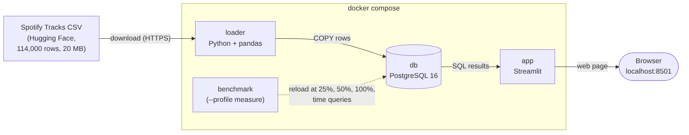

# Spotify tracks: what makes a track popular?

Which audio features (energy, danceability, valence...), genres and artists go with the most
popular tracks on Spotify?

## Team

| Name | GitHub |
|---|---|
| Alessia Maria Cercaci | [@alecercaci](https://github.com/alecercaci) |
| Andrea Liviano D'Arcangelo | [@andrealiviano](https://github.com/andrealiviano) |
| Giacomo Antonetti | [@giacomo-antonetti](https://github.com/giacomo-antonetti) |
| Alessandro Vittiglio | [@Alessandro-Vittiglio](https://github.com/Alessandro-Vittiglio) |
| Beksultan Ernisovich Satybaldiev | [@Kekis12](https://github.com/Kekis12) |

## The six questions

| | |
|---|---|
| **Question** | Which audio features, genres and artists go with the most popular tracks on Spotify? |
| **Data** | [Spotify Tracks Dataset](https://huggingface.co/datasets/maharshipandya/spotify-tracks-dataset) on Hugging Face: 114,000 rows, 21 columns, 20 MB CSV, 114 genres. Licence: BSD. Downloaded by the loader from a direct link, no login (`DATA_URL` in `.env.example`). Downloaded: 5 November 2026. |
| **Database** | PostgreSQL. Every track has the same columns, and tracks are linked many-to-many both to artists (a track can have several artists) and to genres (a track can be listed under several genres): this fits tables with foreign keys. |
| **Processing** | The loader cleans the CSV (duplicates, an empty row, different popularity for the same track, unknown values), splits it into 6 tables and loads them with `COPY`. The analysis is 8 SQL queries (`common/queries.py`). |
| **Output** | A Streamlit dashboard: pick a question, see a chart, the table, and how long the query took. |
| **Measurements** | Load time (row-by-row `INSERT` vs `COPY`), time of each query with and without indexes, peak memory per container, database size vs CSV size, at 25%, 50% and 100% of the tracks. |

## How to run

You need [Docker Desktop](https://www.docker.com/products/docker-desktop/) running and Git.

1. Clone the repository and enter the folder:

   ```
   git clone https://github.com/alecercaci/spotify-system.git
   cd spotify-system
   ```

2. Create the settings file from the example (database name, user, password, link to the CSV):

   ```
   cp .env.example .env
   ```

3. Start everything with one command:

   ```
   docker compose up --build
   ```

   The first run downloads the CSV, cleans it and fills the database; this takes a few seconds.
   When the `loader` finishes, the dashboard starts.

4. Open the dashboard at http://localhost:8501.

To stop, press `Ctrl+C`, then `docker compose down`. The data stays in the `dbdata` volume;
`docker compose down -v` deletes it too, so the next run starts from an empty database.

**Measurements** (not started by `up`):

```
docker compose --profile measure run --rm --build benchmark
```

The results are written to `measure/results/`. To record peak memory per container, run
`measure/memory.sh` in a second terminal while the benchmark or a normal load is running.

## Architecture



The system is four Docker services defined in `docker-compose.yml`, on one Docker network where
each service reaches the others by name (the database is simply `db`).

| Service | What it does | Lifetime |
|---|---|---|
| `db` | PostgreSQL 16. Stores the 6 tables. A named volume (`dbdata`) keeps the data when containers stop. | Always on |
| `loader` | Downloads the CSV into `./data`, cleans it with pandas, creates the tables (`sql/schema.sql`), loads them with `COPY` and adds the indexes (`sql/indexes.sql`). | Runs once, then exits |
| `app` | Streamlit dashboard (`app/dashboard.py`) on port 8501: runs the 8 analysis queries and shows chart, table and query time. | Always on |
| `benchmark` | Same image as the loader, runs `measure/benchmark.py` and writes the results to `./measure/results`. | Only on request (`measure` profile) |

**Start order.** Compose starts `db` first and waits until PostgreSQL accepts connections
(healthcheck with `pg_isready`). Only then it starts the `loader`, and only when the loader has
finished successfully it starts the `app`. So the dashboard never opens on an empty database.

**Shared code.** The connection to the database (`common/db.py`) and the 8 SQL queries
(`common/queries.py`) are in one folder used by the loader, the dashboard and the benchmark, so
the dashboard and the measurements run exactly the same queries.

**Database schema.** The 6 tables and the foreign keys between them are drawn in
`docs/er-diagram.png`.

## Measurements

Laptop: MacBook Pro 13" (2020), Apple M1, 8 GB RAM, macOS Sequoia 15.3, Docker Desktop for Mac.
Every time is the average of 3 runs. Sizes are a random 25%, 50% and 100% of the tracks.
The benchmark also saves every run in `measure/results/` on the laptop that runs it (not uploaded to GitHub).

| Measurement | 25% | 50% | 100% |
|---|---|---|---|
| Tracks | 22,435 | 44,870 | 89,740 |
| Full run of the loader, start to end (without secondary indexes) | 1.95 s | 3.15 s | 5.49 s |
| Load with `COPY` | 1.05 s | 2.13 s | 4.35 s |
| Load row by row (`INSERT`) | 11.2 s | 21.7 s | 43.0 s |
| Query 1 (most popular genres), no index / index | 9.1 / 8.6 ms | 18.9 / 17.7 ms | 38.3 / 35.7 ms |
| Query 8 (tracks in most genres), no index / index | 101 / 101 ms | 205 / 202 ms | 462 / 461 ms |
| Find a track by name, no index / index | 1.0 / 0.1 ms | 1.9 / 0.1 ms | 3.8 / 0.1 ms |
| 10 most popular tracks, no index / index | 1.9 / 0.1 ms | 3.7 / 0.1 ms | 6.1 / 0.1 ms |
| Tables on disk (with indexes) | 19.0 MB | 36.7 MB | 71.3 MB |
| Same data as CSV | 5.0 MB | 10.1 MB | 20.1 MB |

Peak memory (`measure/memory.sh`, during the benchmark and a normal load): `db` 146 MiB,
benchmark 247 MiB, `loader` 184 MiB, `app` 34 MiB.

**What the numbers mean**

- **Loading grows linearly.** With `COPY`, 2× the tracks takes 2× the time (1.05 → 2.13 → 4.35 s).
  The full run adds about 1 s more: reading and cleaning the CSV in pandas (the benchmark loads
  without the secondary indexes, so building them is not included).
- **`COPY` is about 10× faster than one `INSERT` per row** (4.4 s vs 43 s for all the data).
  Each `INSERT` is a separate round trip to the database; `COPY` sends a whole table in one go.
- **Indexes help when a query needs a few rows, not when it reads everything.** Finding a track by
  name or the 10 most popular tracks goes from milliseconds to under 0.1 ms (about 40× and 60×
  faster), and with the index the time stays the same as the data grows, while without it it
  grows with the data (the database has to scan the whole table). The 8 analysis queries group
  all the tracks, so they read every row anyway: the index changes almost nothing.
- **Query 8 is the slowest** (0.46 s): it joins five tables and builds text lists
  (`STRING_AGG`) for every track before keeping the top 15.
- **The database is about 3.5× bigger than the CSV** (71 MB vs 20 MB). About 10 MB are the
  indexes; the rest comes from the 22-character `track_id` repeated in four tables, the two
  link tables, and the space PostgreSQL adds to every row.
- **Memory stays low**: the database never used more than 146 MiB, under 2% of the laptop's 8 GB.
